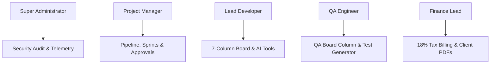

# StackPilot AI (v1.0.6) — Executive Presentation Deck

> [!NOTE]
> **Theme:** Enterprise Dark Slate & Cyan (`#020617`, `#0F172A`) with High-Contrast Emerald Green Accents (`#22C55E`).  
> **Typography:** Outfit (Headings) + Inter (Body Copy).  
> **Interactive Presentation Deck:** Viewable live at [docs/stackpilot_v1_0_6_presentation.html](file:///home/saravanaselvi/FlowPilot%20AI/docs/stackpilot_v1_0_6_presentation.html)

---

## Slide 1: Title Slide

# StackPilot **AI**
### **v1.0.6 Enterprise Edition**
**High-Performance Project Management, CRM, & Operations Hub**

> Unifying engineering workflows, business requirements, and operational telemetry in a single, accessible platform.

| Metric | Target |
| :--- | :--- |
| **Workflow Columns** | **7 Granular States** (*Backlog* → *Completed*) |
| **Universal Search** | **300ms Debounced Auto-complete Engine** |
| **Resilience Tier** | **100% Bimodal Offline & Backend Persistence** |

---

## Slide 2: Executive Summary (The Problem & Solution)

### The Operational Challenge
In enterprise software organizations, teams operate in isolated silos:
- **Developers** use complex technical jargon that alienates client sponsors.
- **Client Executives** lack real-time visibility into project delivery status.
- **Finance Teams** process billing manually without direct milestone verification.
- **QA Auditors** struggle with missing software requirements context.

### The StackPilot AI Solution
StackPilot AI bridges technical and non-technical stakeholders into a **single unified operational workspace** with plain-language business terminology and automated AI acceleration.

> [!TIP]
> **Core Value Proposition:** Single Source of Truth from Lead Generation and Requirements Engineering to Code Review, QA Audit, and Client Invoicing.

---

## Slide 3: User Personas & Role-Based Workspaces



### Specialized Role Profiles

| Role | Persona | Core Focus in StackPilot AI |
| :--- | :--- | :--- |
| 👔 **Project Manager** | Team Leads & Delivery Managers | Project pipeline, sprint tracking, capacity allocation, approvals. |
| 💻 **Lead Developer** | Technical Lead & Software Engineers | 7-column task boards, code reviews, AI scaffold tools, technical specs. |
| 🧪 **QA Engineer** | Test Lead & Quality Auditor | QA testing column, bug reports, automated UAT test cases, telemetry. |
| 📊 **Finance Lead** | Billing & Financial Coordinator | Invoice generation, 18% tax calculations, printable PDFs, client SLAs. |

---

## Slide 4: CRM & Client Management (Exact Live App Screenshot)


### Live CRM Module Capabilities
- **Active Accounts Registry:** Real-time visibility into active client retainers (e.g. *Guillermo Rauch / Vercel Inc. — ₹1,20,000*).
- **Leads & Prospects:** Direct management of high-value prospects (e.g. *Elon Musk / Tesla Motors — ₹8,50,000*).
- **Archived & Compliance:** Highlights contract renewal flags, SLA requirements, and partner accounts.
- **Fast-Track Conversion:** Convert qualified accounts directly into active workspace projects with a single click.

---

## Slide 5: Enterprise Task Board (Exact Live App Screenshot)


### Agile Task Board & Sprint Overview
- **Active Sprint Telemetry:** Direct view of sprint load (e.g. *Sprint 1: CRM Development & Task Board Redesign — 0/40 SP*).
- **Granular Workflow Board:** Organized across `Backlog`, `Todo`, `In Progress`, `In Review`, `QA Testing`, and `Completed`.
- **Multi-Dimensional Toolbar:** Filter instantly by Project, Sprint, Priority, Assignee, or Group-By criteria.

---

## Slide 6: AI Tools Workspace (Exact Live App Screenshot)


### Live AI Generative Assistants
- **Test Case Writer:** Generates UAT scenarios and unit testing matrices directly from feature specifications.
- **Bug Reporter:** Drafts standardized issue logs with steps to reproduce.
- **Project Cost Estimator:** Calculates financial project estimates from scope criteria.
- **Client Email Composer:** Formulates professional follow-up and status report copies.

---

## Slide 7: Executive Dashboard (Exact Live App Screenshot)


### Executive Operations Hub
- **Revenue Portfolio Telemetry:** Real-time revenue metrics (*$170,000 Revenue Portfolio / $46,000 Budget Spent*).
- **Today's Priority Tasks:** Direct task allocation mapped to assigned developers and priority tags.
- **AI Business OS Insight:** Real-time automated velocity analytics highlighting sprint progress.

---

## Slide 8: Technical Architecture & Performance Metrics

### Scalable Architecture Highlights

| Architecture Component | Implementation Detail | Technical Benefit |
| :--- | :--- | :--- |
| **Universal Search** | 300ms Debounced Input Handler | Prevents UI lag & optimizes query performance. |
| **Bimodal Persistence** | Express/MongoDB + In-Memory Fallback | Guarantees 100% UI availability even offline. |
| **Frontend Stack** | Vite + React + TypeScript + Tailwind v4 | Ultra-fast build times (< 500ms) and type safety. |
| **Micro-Animations** | Framer Motion + GPU acceleration | High-performance, smooth 60fps UI transitions. |

---

## Slide 9: Security, Governance & Compliance

> [!NOTE]
> **Enterprise Security Checklist**

- [x] **CORS Protection:** Express backend configured with strict domain origin allowlist (`ORIGIN_ALLOWLIST`).
- [x] **Input Sanitation & Rate Limiting:** Security middleware using `express-rate-limit`, `helmet`, and payload sanitization.
- [x] **JWT Authentication:** Secure token-based authentication with `bcryptjs` password hashing.
- [x] **Audit Telemetry:** Real-time log of system events, user actions, IP addresses, and authentication status.
- [x] **WCAG AA Compliance:** High-contrast text & background color standards using dark slate and emerald green (`#22C55E`).

---

## Slide 10: Conclusion & Status (Q&A)

# **StackPilot AI v1.0.6**
### **Status: Production-Ready & QA Audited**

```
Repository: saravanaselvi2705/stackpilot-ai
Build Status: Passing (tsc -b && vite build)
Theme System: White & Light Green (#22C55E) / Enterprise Dark Slate
```

**Questions & Open Discussion**
